# Offline Fitness Tracker for iPhone: workouts, PRs, body, calories and diet


> An offline iPhone app for strength training. Log your sets, see the weight to lift next for every exercise, spot your PRs at a glance, track body weight, calories and measurements, and keep a daily diet whose calories feed your calorie target. Everything lives in one SQLite file on your phone: no account, no server.

## Screens

Screenshots of the real app.

### Training

<table>
  <tr>
    <td align="center">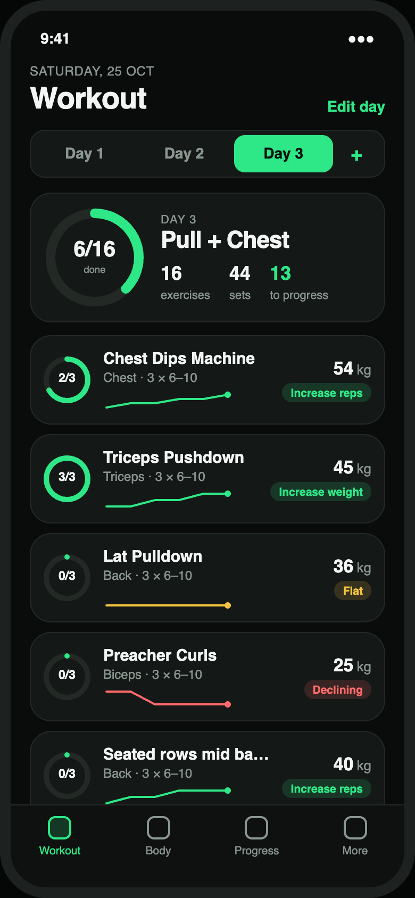<br><sub><b>Workout day</b><br>every exercise with its target; <i>All</i> shows everything</sub></td>
    <td align="center">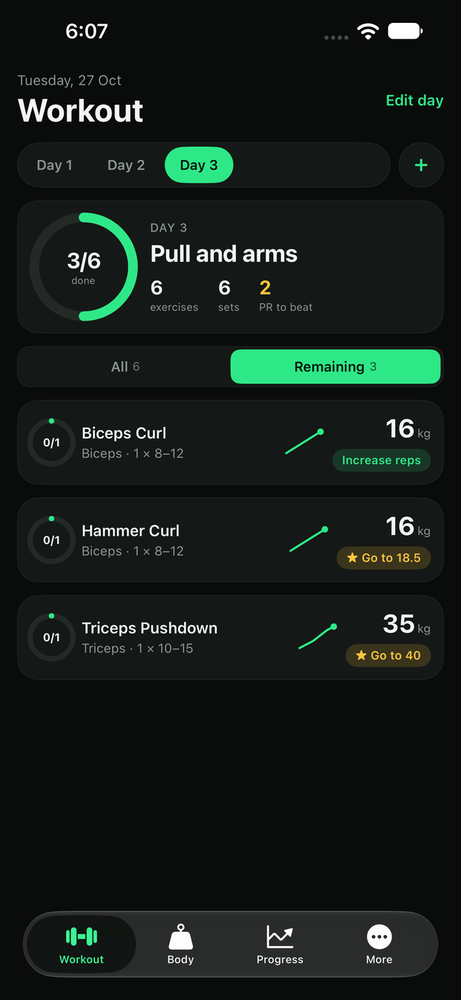<br><sub><b>Remaining</b><br>hides what is already logged today</sub></td>
    <td align="center">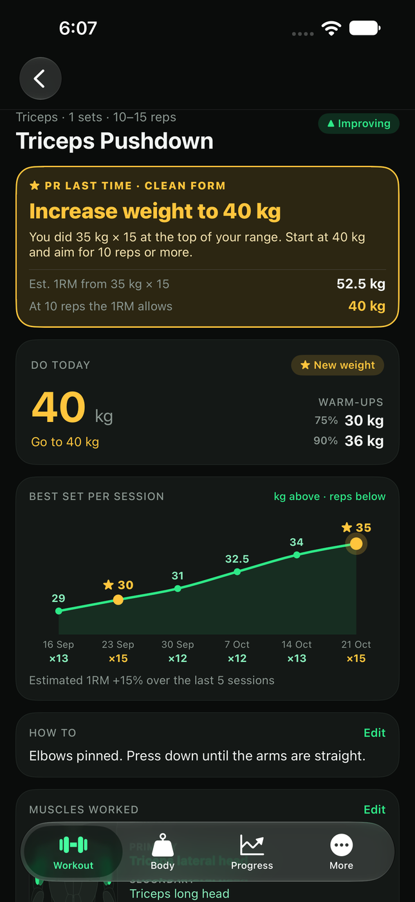<br><sub><b>PR banner</b><br>gold banner, next weight, estimated 1RM, gold ★ dot</sub></td>
  </tr>
  <tr>
    <td align="center">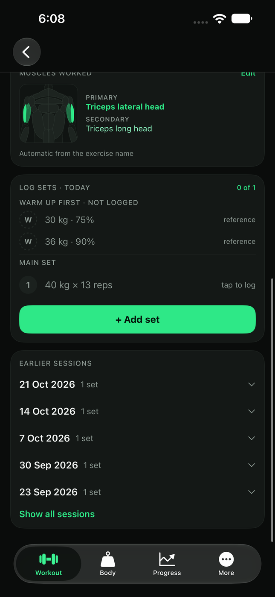<br><sub><b>Log sets</b><br>warm-ups as reference, one main set, earlier sessions to edit</sub></td>
    <td align="center">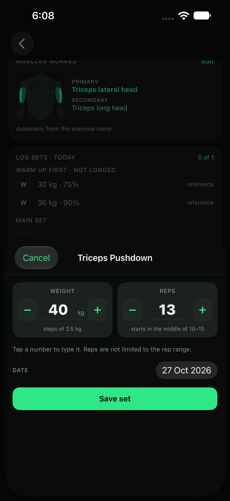<br><sub><b>Add set</b><br>− / + on weight and reps, reps start mid-range</sub></td>
    <td align="center">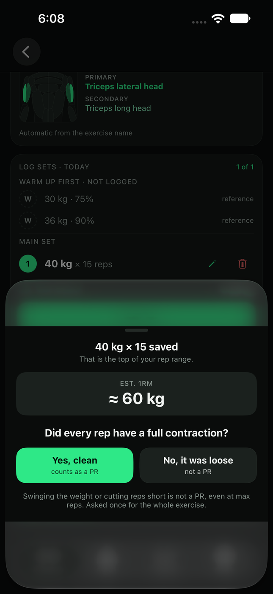<br><sub><b>Clean-form check</b><br>asked once when you reach the top reps</sub></td>
  </tr>
  <tr>
    <td align="center">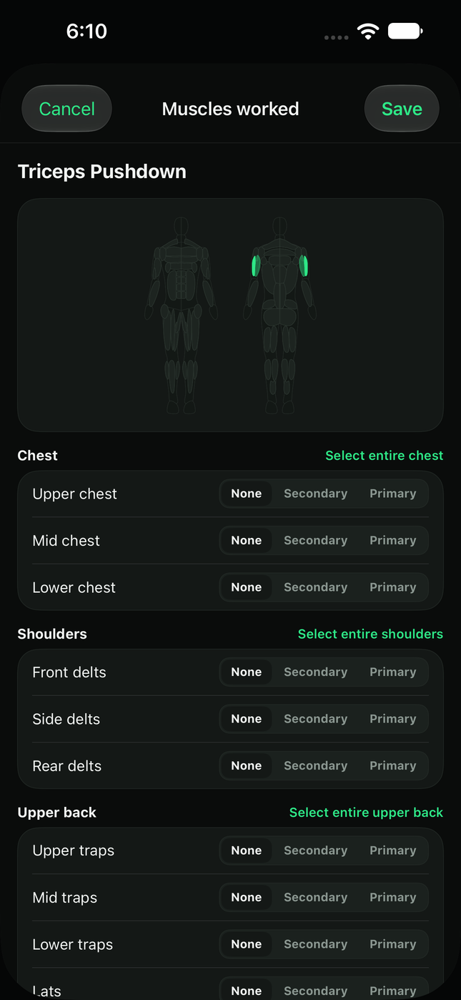<br><sub><b>Muscles worked</b><br>pick a whole region or single muscles</sub></td>
    <td align="center">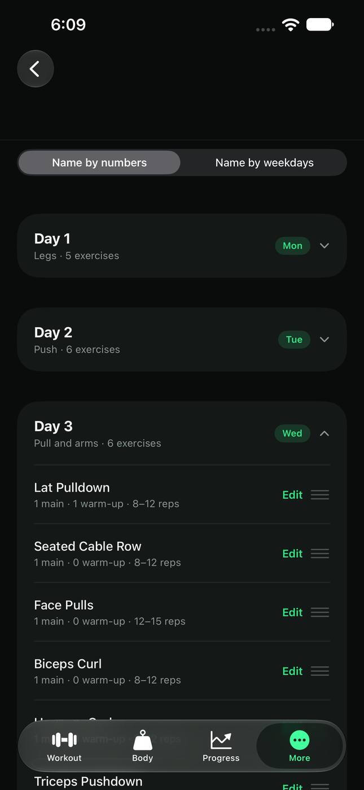<br><sub><b>Edit plan</b><br>main sets, warm-up sets, rep range</sub></td>
    <td align="center">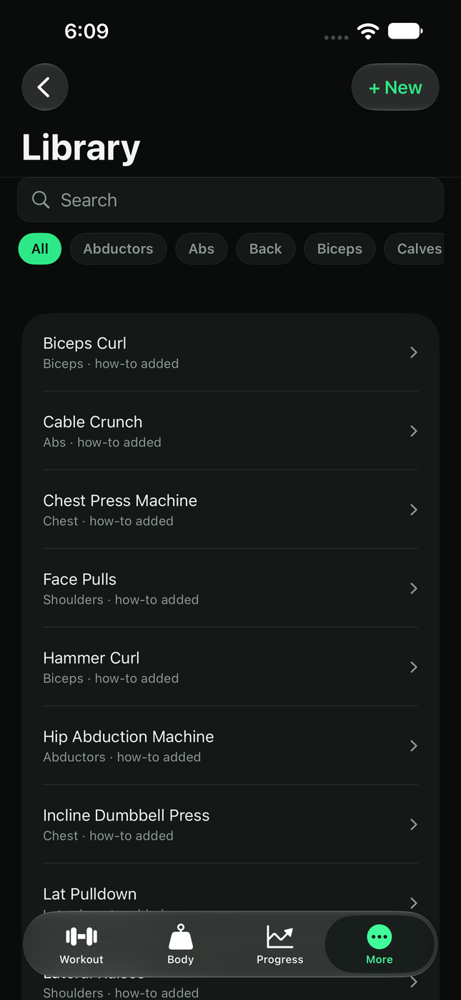<br><sub><b>Exercise library</b><br>names, muscle groups, how-to</sub></td>
  </tr>
</table>

### Body, progress and settings

<table>
  <tr>
    <td align="center">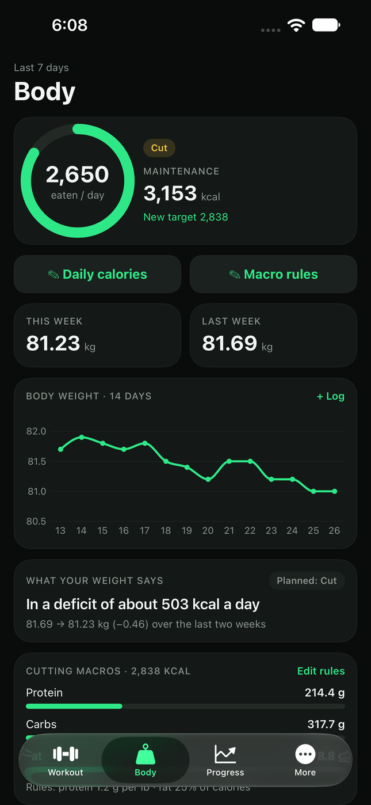<br><sub><b>Body</b><br>calorie target, weekly weight, what your weight says</sub></td>
    <td align="center">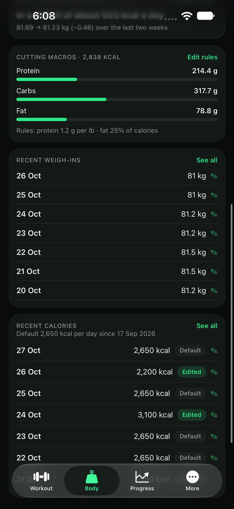<br><sub><b>Daily calories</b><br>default from a date, edit any day</sub></td>
    <td align="center">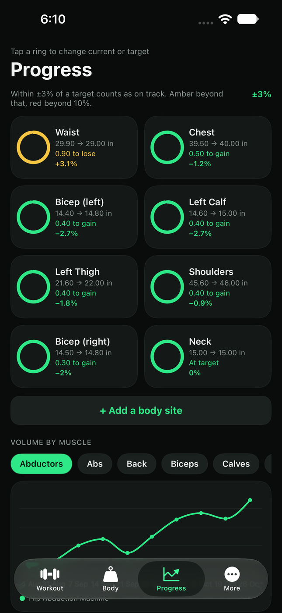<br><sub><b>Progress</b><br>measurements with % from target, volume per muscle</sub></td>
    <td align="center">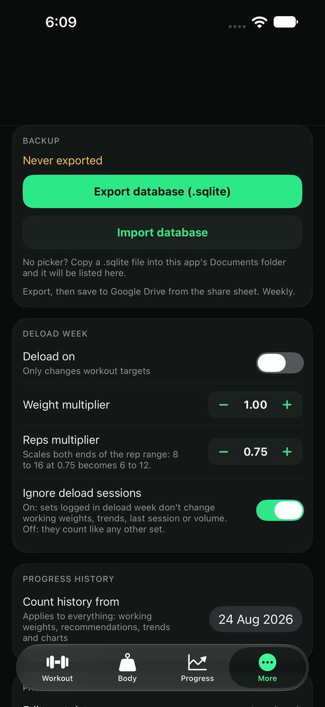<br><sub><b>More</b><br>backup, deload, history start, past data</sub></td>
  </tr>
</table>

## Features

**Training**
- **Workout per day:** each exercise shows its working weight and a progression chip. Pick a day, tap an exercise, log.
- **All / Remaining filter:** *Remaining* hides the exercises you have already finished today, so the last ones are not many scrolls away. The app always opens on *All*.
- **Main and warm-up sets:** the main set is logged and counted (the circle reads 0/1). Warm-ups (0 to 3 per exercise) are listed with their weights as a reference and are never logged.
- **PRs in gold:** reaching the top of the rep range with clean form is a PR. It shows as a gold banner, a gold ★ on the best-set chart and a gold chip on the list, with the next weight worked out from your estimated 1RM. If the form was not clean the app says to repeat the weight instead.
- **Clean-form check:** one question, asked once per exercise per day when you reach the top reps: "Did every rep have a full contraction?".
- **Fast logging:** − / + buttons on weight (2.5 kg steps) and reps, reps start in the middle of the range, log a set for an earlier day, edit or delete any set, and look up or fix any past day.
- **Best-set chart:** the best set of each session as a line (kg above each point, reps below), plus the estimated 1RM after every set.
- **Muscle diagram:** shows which muscles an exercise trains. It is automatic and editable per exercise, with a picture for every side of the body that has a worked muscle.
- **Deload mode:** a lighter week that scales the weight and both ends of the rep range for display only, with an option to ignore deload sessions in your progress.
- **Saved workouts:** Edit plan → Saved workouts keeps the whole workout plan under a name, lets you tap or preview any workout's days, muscle counts, and exercises before switching, and lets you duplicate, rename, or delete any saved workout (including presets). Logged sets belong to exercises, so history and working weights carry over.
- **Routines:** ready groups of exercises (like recipes for food), browsable by muscle (matching both exercise group labels and primary muscle anatomy such as *Back*, *Shoulders*, *Chest*, *Arms*, *Legs*). Create a routine from scratch with **+ New routine**, edit/duplicate/rename/delete any routine (including presets), save any workout day as a routine, and use *+ Add routine* on a day to copy its exercises in (exercises already there are skipped).
- **Coach presets:** coach routines and workouts (`output/meridian-presets.json`), synced silently on launch; use, duplicate, edit, rename, or delete them freely.
- **Plan and library editing:** add, rename, reorder and delete days and exercises, set main sets, warm-up sets and rep ranges, and name days by number or weekday.

**Body and progress**
- **Weigh-ins:** log your weight on any day, edit or delete old ones.
- **Calories & deliberate Goal Mode:** a daily default that starts on a date you choose, a single-day override, and an explicit **Goal Mode** (`Maintain`, `Cut`, `Bulk`). Diet breaks, refeeds, and cutting-speed checks fire **only** when Goal Mode is explicitly set to *Cut*, so natural weight loss while eating cleaner at Maintenance never triggers cutting alerts.
- **Effective calories:** digestion uses part of what you eat (protein 25%, carbs 7.5%, fat 1.5%, alcohol 0%: the middle of the vault's ranges). The Body card shows total and effective side by side; *Details* breaks the cost down by macro and chooses whether targets and maintenance use total or effective calories. Saved diets show both too.
- **Refeeds (while cutting):** a card on Body lets you pick refeed weekdays or dates, with the vault's guidance (1–2 days at maintenance, extra mostly carbs, protein and fat unchanged). On a refeed day it shows the maintenance target and you mark it *Refeed done*, *Normal day* or *Skipped*. After 6 weeks of deliberate cutting Room for improvement suggests a 1–2 week diet break (stronger at 12), and cut-rate checks wait 3 days after a refeed.
- **What your weight says & Bloodwork:** your actual deficit or surplus from the weight trend sits right above **Bloodwork** on Body, above *Recent weigh-ins* and *Recent calories*.
- **Break mode:** start a break today or plan one with dates (More → Break mode). Break days need no food, workouts or weigh-ins and are left out of the calorie maths. Afterwards the Body tab says *Recalibrating* until there are 14 days of weigh-ins after the break (two clean weeks to compare), and keeps a *Before your break* card with maintenance, what you were eating, whether you were cutting or bulking, and your weight before and after.
- **Calorie history:** step back (‹ ›) or pick any past day on the Body tab to see maintenance, calories eaten, deficit or surplus, the target and cutting macros as they stood that day, worked out only from weigh-ins and food up to then.
- **Measurements & site units:** targets that grow or reduce in `in`, `mm`, `cm`, or `%` (caliper skinfolds in `mm`, body fat in `%`, tape sites in `in`/`cm`), % from target, and a colour tolerance (green, amber, red). Open a site and tap **+ Add reading** or switch its unit.
- **Volume per muscle:** training volume over time for each muscle group.

**Diet**
- **Food library:** foods, supplements and packaged snacks with nutrition (per 100 g, per serving or per piece) and price. Optional extra nutrients fold away by group: 11 amino acids, MUFA/PUFA/trans fat, EPA/DHA/ALA/omega-6 and the omega-3 form, alcohol (7 kcal/g) and caffeine, 15 vitamins (including **Vitamin D** in `mcg` and **Vitamin D3** in `IU`, which combine automatically at `40 IU = 1 mcg` and display both `mcg` and `IU` on targets and coverage screens), 10 minerals, and **Compounds & functional ingredients** (**Creatine monohydrate**, **Glycine**, and **Psyllium husk** in `g`). A blank is *unknown*, never 0, and recipes add their ingredients up; a trans-fat extra shows a red dot and its grams. Calories come from the label when you type them, otherwise from protein, carbs and fat. Editing a food updates every day that used it.
- **Recipes:** a recipe is made of other foods, for one piece or a whole batch ("makes 9 pieces", "makes 1000 g"). Its nutrition and cost are worked out from the current ingredients. *Cook for* shows every ingredient scaled to another amount (11 pieces → 5) without changing the recipe, and *Duplicate as a new recipe* copies it under a new name to make a variation (Maintenance shake → Soybean shake).
- **Daily plan:** your meals and quantities. A change starts on a date you choose (today by default) and never rewrites earlier days. Nothing counts until you tick it: tick an item, or one box to tick a whole meal, as you eat. A new meal can be placed anywhere ("After Brunch"), and the ↑ ↓ arrows move a meal; like every plan change they apply from the edit date, so earlier days keep their meals.
- **Extras:** log something that is not in the plan by pieces, grams or share of a pack ("4 biscuits" from a 250 g pack of 35), see the result before saving, and re-add recent extras in one tap. Tap an extra to change how much (3 pieces to 4) without adding another, or remove it. Each extra can say when it was eaten (Morning, Noon, Evening, Night; guessed from the clock) and carry a note, and the list is grouped by time of day.
- **Quick add:** for food with no label. *By weight* logs grams against a preset food whose unit stands for a weight (fill in "grams one unit stands for" on the food); *Calories only* logs just the calories. Both take a name of their own ("Kaju katli"). Upgrading to schema 19 makes "Extra calorie batches" 12.7 g carbs + 5.5 g fat per 100 kcal batch (70/30 by grams, as outside snacks and sweets are mostly carbs) standing for 20 g of food, and recounts every day it was logged.
- **Did you eat these?** When you open today in Diet, planned meals of the last 7 days that were left unticked are listed: *Ate it* ticks the meal on its day, *Skipped* records that you really skipped it so the app stops asking. Break days and days with typed calories are never asked about.
- **Saved diets:** Plan → Saved diets keeps the diet in force under a name ("High-protein 2-meal") with its meals, totals and an *In force* tag. Tap or preview any saved diet to inspect every meal, food, quantity, cycle, and macro breakdown before switching; *Use from…* switches the plan to a saved diet from any date, while earlier days keep the diet they had.
- **Cycles:** an item can follow a cycle: weeks on and off counted Monday to Sunday (for example 2 on, 1 off), days on and off, chosen weekdays, or training days. Off days are greyed, not counted in calories or cost, and need no tick.
- **Targets:** protein is a minimum (180 g by default). Fat follows the vault: 20–35% of the day's calories, and never under 0.8 g per kg of 7-day average body weight (whichever is higher is the minimum). All the numbers are editable.
- **Cost and calories:** every day shows its total calories, macros and cost. The Body tab, the weekly average and the calorie target use these days.

**Supplements** (More → Tools → Supplements)
- **Library:** every supplement the vault covers, *worth taking*, *conditional* or *not recommended*, with the reason, dose, forms, timing, cycling, test-first markers, interactions and side effects. Search a product before you buy it. Where the vault gives two different numbers both are shown as *unresolved*. Each test-first line shows your latest matching lab result (or "not tested yet").
- **Your supplements:** each supplement in your foods is matched to the library, and daily grams of Creatine monohydrate (`3–5 g`), Glycine (`3–5 g`), and Psyllium husk (`5–10 g`) sum across all foods, blends (such as a mass gainer), recipes, and supplements regardless of product naming. Room for improvement flags a dose outside the vault's range, a not-recommended product, test-first supplements with your latest result for each test, and starting two new supplements less than 2 weeks apart.
- **Multivitamin stack & optimizer:** lists every tracked vitamin and mineral explicitly with `0 / target` when absent (never `"unknown"`), lets you combine 0–3 units across multiple multivitamins (*Becadexamine*, *A to Z*, *Supradyn*, etc.) in *Tablets only* or *With today's food* mode, flags fat-soluble (A, D, E, K) and Upper Limit breaches, and includes a one-tap **Suggest Best Stack** optimizer for highest safe target coverage.
- The library file (`output/supplement-library.json`) is in the repository and bundled at build time.

**AI diet review** (More → Tools → Export diet for AI review)
- Writes one markdown file: the planned day meal by meal (calories, protein, fibre, leucine), the eaten average over the logged days of the last 14 (each nutrient against its daily target, plus which nutrients have no data), extras eaten, supplements with their library verdict, and open Room for improvement items.
- Share it with an agent that has read the vault. It checks what the app deliberately does not: iron vs tea and coffee, soaking and sprouting, omega-6 sources, absorption pairings and supplement timing. Reviews are saved to `docs/reviews/`, which is git-ignored.
- Run it whenever the diet changes.

**Bloodwork** (Body → Bloodwork; shown when `output/labs-catalogue.json` is bundled)
- **Guided quick-start & ★ Mandatory Core Tests:** a 4-step plain-English *How Bloodwork Works* walkthrough, gold **★ Core** badges on the ~22 foundational Tier-1 markers, and a top *★ X Mandatory Core Tests Pending* tracker splitting *Never tested* vs *Retest due* so you never wonder if all 80+ markers must be ordered at once.
- **Visual range bars:** proportional color-coded horizontal spectrum bars (*Low → Normal → Optimal green → High*) with a glowing **You** pin on every numeric marker screen and compact mini-bars inside each draw.
- **Profile & strict sex filtering:** a one-tap *Male / Female* confirmation banner on first visit (editable in Settings, alongside date of birth, athlete/smoker/ancestry flags, and female cycle/pregnancy/HRT stage). Selecting *Male* shows strictly Male and All-Adults bands, panels, checklists, and notes; selecting *Female* shows strictly Female and All-Adults items.
- **Draws & smart unit scaling:** add a draw with its date, time, lab and pre-analytic state (hours fasted, hard training in 72 h, alcohol, biotin and iron stopped, recent illness, sleep, acute stress, recent vaccine/surgery, medications, and cycle day for women). Each result row shows the expected unit and typical range, auto-converts marker-specific conventional/SI/molar/affine units (including glucose, lipids/cholesterol `mmol/L`, albumin & hemoglobin `g/L`, hormones `pmol/L` / `nmol/L` / `µmol/L`, BUN `urea mmol/L`, and magnesium/zinc/selenium molar units, while reading isoform-variable markers such as Lp(a) directly against native `nmol/L` or `mg/dL` bands), warns and offers a 1-tap unit switch on 10×/100×/1000× scale mismatches, accepts custom unit multipliers when a lab prints an unlisted unit, and supports `< LOD` detection limits, dipstick words, titers (`1:80`), assay selection (`LC-MS/MS`, `Equilibrium dialysis`, `Immunoassay`), and paired Systolic/Diastolic blood pressure.
- **Pre-analytic validity gate:** checks collection time (7–10 AM hormone peak), fasting (skipping fasting-exempt markers), biotin/training/alcohol/iron/illness washouts, assay pitfalls, and urinalysis specific gravity (`< 1.005` dilution masking, `> 1.030` concentration artifact) and squamous contamination before flagging a result.
- **Demographic strata, reading & trajectory:** selects the matching reference and optimal stratum for your sex, age at draw date, assay/specimen, and modifiers; unions adjacent undisputed optimal sub-bands while keeping true vault contradictions as *disputed zone*; reads `needsLabRange` tests against your lab's ULN; and tracks draw-over-draw deltas, annualized velocity (PSA, eGFR, Globulin, Cortisol:DHEA-S vs personal baseline), 2-draw persistence, and baseline resets when switching commercial labs.
- **Calculated ratios & 6 pattern engines:** works out same-draw ratios (HOMA-IR, TG:HDL, TC:HDL, non-HDL, remnant cholesterol, globulin, A/G, BUN/creatinine, AST/ALT, corrected calcium and sodium, anion gap, transferrin saturation, UIBC, NLR and MLR including auto-derived differential counts, Mentzer, zinc:copper, T:E2, DHT/T, Free T3:reverse T3, Cortisol:DHEA-S, Free PSA %, spot UACR), evaluates the 6 multi-marker pattern engines (*Thyroid Conversion*, *HPA Axis Dysregulation*, *Inflammation Cascade*, *Iron & Inflammation*, *Metabolic Dysfunction Cluster*, *Heart Risk*) with matched phenotypes, progression stages, differential look-alikes, read-only Diet/Training/Waist context, and cross-marker discordance alerts.
- **Safety escalation & stepped actions:** unconditional and symptom-paired panic checks, multilineage cytopenia detection, specialist routing, stepped interventions (*Foundations → Nutrition → Supplements → Educational Tier 4* when drug notes are on), and red *What not to do* guardrails.
- **Plan a draw:** sex-filtered baseline panels with per-marker draw/assay notes, automatic reflex follow-up `co_tests` for out-of-optimal markers, optional Tier 2/3 upgrades, interactive Draw-Day Checklist (*Night before*, *Morning of*, *Post-draw*, *What to record*), prep countdown timeline, and retest windows.
- **Genetics (Volume 07), TRT/Rx context & AI export:** 24 clinical gene rules organized into 5 action categories (*Hard safety rules & doctor referrals*, *Changes the form you take*, *Changes how a blood marker is read*, *Tightens targets & screening timing*, *Changes nothing — bloodwork wins*), a one-tap **TRT & Rx** clinical context sheet (initial prompt + editable anytime on Bloodwork, Genetics, and Labs Settings), automatic cross-checks against your active Diet Plan supplements/nutrients (`MTHFR` folic acid, `HFE` iron/Vit C, `LCT` lactose, `CYP1A2` caffeine, `GSTM1` NAC detox stacks, `CYP2D6/2C19` St. John's Wort), genotype-adjusted readings (`FUT2` B12 caveat, `APOE e4` `ApoB ≤ 60 mg/dL`, `Factor V + TRT` `Hematocrit > 52%`), external specialty lab orders (`tTG-IgA / Total IgA` for `HLA-DQ2/DQ8`), and enriched `labs-review-<date>.md` export.

**Room for improvement** (Diet → Today)
- **Today:** what fired today or yesterday, worst first: trans fat (Fix), leucine under 3 g in a protein meal, fiber under 14 g per 1,000 kcal (with the psyllium fix), fat outside 20–35% / under 0.8 g per kg, EPA + DHA under 250 mg, caffeine in the evening (stop 8–10 h before bed), and your own rules: flax or chia, collagen not counted. *Dismiss* hides an item for that day.
- **Trends:** each rule over 7, 30 or 90 days as a strip (red fired, green fine, grey no data) with "fired on x of y days".
- **Setup:** one-time fixes to the diet plan: fewer than 3 protein meals, planned meals under 3 g leucine, low fiber or fat, omega-3 form not rTG or algae. They go away when the plan is fixed, or *Accept* them.
- **Training:** back-to-back weekdays that train the same muscle (leave ~48 h; spreading days uses more of the 24–48 h protein window), a deload when a key lift (the first exercise of a day) drops 2 sessions in a row, 4–8 weeks pass without one, or recovery signs pile up (one tap turns deload mode on), a stalled key lift (no new best in 4 sessions), weekly hard sets per muscle outside 10–20, and a cut outside 0.5–1% of body weight a week or a surplus outside 5–10% (only when Goal Mode is explicitly set to *Cut* or *Bulk*).
- **Labs:** doctor alerts, results outside optimal (with the vault's actions for that side), disputed zones, patterns across markers, retests due and gene items; *Dismiss* hides one. **Archived:** accepted items (still tracked) and rules that don't apply to you (not checked); *Restore* brings them back.
- **Check-in (optional):** on Diet → Today, urine colour (Clear, Pale yellow, Dark yellow), a walk tick after each meal (any time that day; yesterday stays editable), heavy sweat yes/no, and once a week the signs of being under-recovered. Unanswered is no data. Dark urine 2 days running, clear 3 days running, and 3+ recovery signs two weeks running show up in Room for improvement; walks are only a weekly share.
- **Sweaty activity (More → Tools):** for a hike or long sweaty session, how much Himalayan salt and potassium chloride to put in the water you carry and how often to sip, from the vault's per-hour numbers. Your daily workout mix is left as it is.
- **Meal Profile (GL & Amino Acids) & Daily targets:** each real food meal (*Brunch*, *Dinner*) shows a **Meal Profile** sheet with total Meal Glycemic Load (`GL = Σ GI × Net Carbs / 100`, Low/Medium/High) and per-meal Amino Acids (`Leucine 2.9 g`, `Isoleucine 1.3 g`, `Histidine 1.0 g`, etc.), plus descending food contributor `%` drill-downs when you tap GL or any amino acid. Whole-day *Daily targets* tracks fiber, vitamins, minerals and omega-3/6 with `0 / target` for absent nutrients.

**Data**
- **One SQLite file** on the phone. Export it, restore it, or import another one. Older files are upgraded automatically.

## Quick Start

For developers. Developed with Xcode 27.1 (Swift 6.4); the package targets iOS 16 and later. You also need [XcodeGen](https://github.com/yonaskolb/XcodeGen) (`brew install xcodegen`).

```bash
git clone https://github.com/ihiteshmodi/iphone-fitnessapp.git
cd iphone-fitnessapp

swift test                # logic tests, no simulator needed
# Expected (last lines): Executed 533 tests, with 10 tests skipped and 0 failures (0 unexpected)
#   the 10 skipped need a seeded database (see "Configuration")

xcodegen generate         # creates FitnessApp.xcodeproj from project.yml
# Expected: Created project at .../FitnessApp.xcodeproj

open FitnessApp.xcodeproj # pick an iPhone simulator and press Run
# Expected: the app opens on "Set up your data"; choose "Start empty" to try it
```

## Everyday commands

```sh
swift test                                   # logic tests, no simulator needed
cd tools/seed-db && python -m pytest         # seed tool tests (needs its own venv)
xcodegen generate                            # creates FitnessApp.xcodeproj from project.yml
scripts/run-ui-tests.sh WorkoutFlowUITests   # one UI test class, live progress, Ctrl-C to stop
```

The UI test runner shows a live progress bar and stops when the tests finish. It runs on the iPhone 15 Pro Max simulator, the only device the app is used on (set `SIM_UDID` to use another). It uses `output/fitness.seed.sqlite` (build it with `tools/seed-db/build_seed_db.py`); `DietUITests` and `PhaseAUITests` add the made-up demo diet on top.

Layout review: `PhaseATourUITests` screenshots every Phase A screen. Run it on a migrated copy of your own database to see real names and amounts:

```sh
UI_SEED_DB=/path/to/migrated.sqlite scripts/run-ui-tests.sh PhaseATourUITests
xcrun xcresulttool export attachments --path .uitest-logs/PhaseATourUITests.xcresult --output-path .shots
```

## Build an unsigned .ipa (for LiveContainer)

```sh
xcodegen generate
xcodebuild -project FitnessApp.xcodeproj -scheme FitnessApp -configuration Release -sdk iphoneos \
  -destination 'generic/platform=iOS' -derivedDataPath .derived-device \
  CODE_SIGNING_ALLOWED=NO CODE_SIGNING_REQUIRED=NO CODE_SIGN_IDENTITY="" build
# ** BUILD SUCCEEDED **
mkdir -p Payload && cp -R .derived-device/Build/Products/Release-iphoneos/FitnessApp.app Payload/ && zip -qry FitnessApp.ipa Payload
# FitnessApp.ipa is created in the current folder
```

If `output/fitness.sqlite` exists at build time it is bundled and offered as **Load my data** on first launch. Without it the build contains no data and the app starts on **Set up your data**.

## Install the .ipa on your iPhone

The .ipa you build is unsigned, so it has to be installed with a sideloading tool. Pick one:

**LiveContainer** ([project page](https://github.com/khanhduytran0/LiveContainer))
1. Install LiveContainer on your iPhone (it is itself sideloaded, see its README).
2. Get `FitnessApp.ipa` onto the phone (AirDrop, iCloud Drive or the Files app).
3. In LiveContainer open the **Apps** tab, tap **+**, and choose `FitnessApp.ipa`. Wait for it to finish installing.
4. Tap the app in the list to launch it.
5. If the file picker will not let you select a database file inside the app, open the app's settings in LiveContainer and turn on **Fix File Picker**.

**AltStore or SideStore** ([AltStore](https://altstore.io), [SideStore](https://sidestore.io))
1. Install AltStore or SideStore on your iPhone and sign in with your Apple ID.
2. Put `FitnessApp.ipa` on the phone, open the store app, go to **My Apps**, tap **+** and choose the file.
3. With a free Apple ID the app expires after 7 days; refresh it from the store app to keep it.

**Sideloadly** (Mac or Windows, [sideloadly.io](https://sideloadly.io))
1. Connect your iPhone, open Sideloadly and drag `FitnessApp.ipa` into it.
2. Enter your Apple ID and click **Start**.
3. On the iPhone, open **Settings → General → VPN & Device Management** and trust your Apple ID profile.

On iOS 16 and later you may also need to turn on **Developer Mode** (**Settings → Privacy & Security → Developer Mode**) and restart the phone. Menu names can differ slightly between versions.

## Usage

### Track your diet

1. **Diet** tab → **Foods**: add your foods (**+ New food**) with their label values, and recipes (**+ New recipe**) with their ingredients.
2. **Plan**: add each food to a meal with its quantity. Changes start on the date shown at the top (today by default). Tap an item to give it a cycle, such as 2 weeks on and 1 week off.
3. **Today**: nothing counts until you tick it. Tap an item to tick it as eaten, or tap the box next to a meal's name to tick or clear the whole meal. **+ Add extra** logs anything else.

Worked example (a 250 g pack of 35 biscuits, label per 100 g: 480 kcal, protein 7, carbs 70, fat 18; you ate 4):

```text
One piece:   250 ÷ 35 = 7.14 g
4 pieces:    4 × 7.14 = 28.6 g
Calories:    480 × 28.6 ÷ 100 = 137 kcal  (protein 2.0 g, carbs 20.0 g, fat 5.1 g)
```

Importing an existing spreadsheet of foods and a diet is possible with [`tools/diet-import`](tools/diet-import/README.md).

### Log a workout day

1. **Workout** tab: pick a day. Each card shows the working weight and a chip: green *Increase reps*, amber *Same weight, clean*, or gold *★ Go to 72.5*.
2. Tap **Remaining** to hide the exercises you have finished.
3. Open an exercise. Follow the warm-up weights, then tap **+ Add set**. Weight and reps have − / + buttons; tap a number to type it.
4. If the reps reach the top of the range, the app asks **"Did every rep have a full contraction?"**. Yes counts as a PR; No means the same weight next time.

Worked example (rep range 10 to 15, last session 35 kg × 15, answered Yes):

```text
Banner:        ★ PR last time · clean form — Increase weight to 40 kg
Est. 1RM:      35 × (1 + 15 / 30) = 52.5 kg
Next weight:   52.5 ÷ (1 + 10 / 30) = 39.4 → rounded to the nearest 2.5 kg = 40 kg
Do today:      40 kg   (warm-ups at 75% = 30 kg and 90% = 36 kg when 2 warm-up sets are planned)
```

## Configuration

There are no environment variables or secrets. The app is configured by settings stored in the database (change them in the app) and by two optional build-time files.

### Settings (stored in the `settings` table)

| Setting | Where in the app | Default | Required |
|---|---|---|---|
| Count history from | More → Progress history | `2026-08-31` (seeded) | No |
| Name days by | More → Plan / Edit plan | numbers | No |
| Deload on | More → Deload week | off | No |
| Deload weight multiplier | More → Deload week | `1` | No |
| Deload reps multiplier (both ends of the rep range) | More → Deload week | `0.75` | No |
| Ignore deload sessions in progress | More → Deload week | on | No |
| Protein g per lb | Body → Macro rules | `1.2` | No |
| Fat % of calories | Body → Macro rules | `25` | No |
| Protein minimum (diet) | Diet → Plan → Targets | `180` g | No |
| Fat share of calories (diet) | Diet → Plan → Targets | `20` % | No |
| Fat ceiling per lb of body weight (diet) | Diet → Plan → Targets | `0.4` g | No |
| Measurement tolerance | Progress → ±3% | `3` % (amber beyond it, red beyond 10%) | No |

### Build-time and launch options

| Option | What it does | Default | Required |
|---|---|---|---|
| `output/fitness.sqlite` | If presNon-personal coach routine & workout templates; in the repository, bundled, and synced silently on launch | bundled | No |
| `output/nutrient-values.csv` | Approved reference nutrient & glycemic-index values for foods (`name,key,amount`); in the repository, bundled, and synced silently on launch | bundled | No |
| `output/supplement-library.json` | The vault's supplement library; in the repository and bundled (More → Supplements) | absent (library hidden) | No |
| `output/labs-catalogue.json` | The bloodwork and genetics catalogue compiled by `tools/labs-catalogue/compile_clinical_rules.py` (and `merge_catalogue.py`); bundled when present. The vault's content, so it stays out of the repository | absent (Labs hidden) | No |
| `-UITestImportPath <file>` | Simulator tests only: import this database at launch | unset | No |
| `-UITestInitialTab <0-4>` | Simulator tests only: start on a tab (0 Workout, 1 Body, 2 Diet, 3 Progress, 4 More) | `0` | No |

## Reference

This app has **no server and no HTTP API**. This section documents the local database and the rules the screens follow.

### Database tables (schema version 22)

| Table | Holds |
|---|---|
| `exercises` | Library: name, muscle group, how-to |
| `plan_days`, `plan_entries` | Training days and their exercises: main `sets`, `warmup_sets` (0 to 3), min and max reps |
| `set_logs` | Every logged set: date, exercise, weight kg, reps, deload flag |
| `form_checks` | Clean-form answer per exercise per day (1 clean, 0 not clean) |
| `saved_workouts`, `saved_workout_days`, `saved_workout_entries` | Whole workout plans kept under a name (presets are read-only) |
| `routines`, `routine_entries` | Ready groups of exercises with sets and rep ranges |
| `exercise_muscles` | Muscles chosen per exercise (no rows means automatic) |
| `body_weights`, `body_measurements`, `measurement_targets` | Weigh-ins, readings, targets with a grow or reduce direction and unit (`in`, `mm`, `cm`, `%`) |
| `calorie_defaults`, `calorie_entries` | Calories per day from a start date, and single-day overrides |
| `food_nutrients` | Extra nutrients per food (leucine, trans, epa, vitamin_d…); no row means unknown |
| `foods`, `recipe_items` | Foods, supplements and packaged snacks with nutrition, glycemic index (`0–115`) and price; recipes and their ingredient lines |
| `diet_plans`, `diet_plan_items` | The daily plan from a start date, with each item's meal, quantity and cycle |
| `diet_meal_skips` | Planned meals knowingly skipped on a day |
| `diet_day_ticks`, `diet_extras` | Plan items ticked as eaten on a day, and extras eaten on top of the plan (with an optional name, time of day and note) |
| `saved_diets`, `saved_diet_items` | Diets kept under a name: a copy of the plan's meals, foods, quantities and cycles |
| `break_periods` | Break mode: start and end day of each break (no end while it is still on) |
| `insight_dismissals`, `insight_rules` | Room for improvement: items dismissed for a day, and rules accepted or marked as not applying |
| `checkins`, `meal_walks`, `recovery_signs` | The optional check-in: urine and sweat per day, walks after meals, weekly recovery signs |
| `refeed_days` | Refeed dates chosen while cutting and what each day was marked |
| `lab_draws` | Blood draws: date, time, lab and pre-analytic state (fasted hours, hard training in 72 h, alcohol, biotin/iron stopped, recent illness, sleep, acute stress, vaccine/surgery, medications, cycle day) |
| `lab_results` | One result per marker per draw: numeric value, optional `<` / `>` limit operator, paired secondary value (BP diastolic), qualitative/titer text, custom unit multiplier, specimen/assay, and optional printed lab range |
| `lab_genotypes` | One genotype per gene, picked from that gene's table in the genetics volume, with the date it was entered |
| `settings` | The settings above |

The schema lives in `src/shared/database/schema.sql`. Older files are upgraded in place when opened (versions 1 to 6 are covered by tests).

### Rules

| Rule | Definition |
|---|---|
| Estimated 1RM | Epley: `weight × (1 + reps ÷ 30)` |
| PR | A session reaching the top of the rep range with clean form (older sessions without an answer count as clean). Not during deload |
| Next weight after a PR | `1RM ÷ (1 + min reps ÷ 30)`, rounded to the nearest 2.5 kg, always above the weight lifted |
| Reps in Add set | Start at `ceil((min + max) ÷ 2)`, for example 8 to 16 gives 12 |
| Warm-ups | 1: 75%. 2: 75% and 90%. 3: 60%, 75% and 90% of the working weight |
| Calorie target | Maintenance = calories eaten minus the daily surplus implied by the change between the last two 7-day average weights (3,500 kcal per lb). Calories eaten = the average of the 7 days ending the day **before** the latest weigh-in, so a morning weigh-in never pulls in the day still being logged; a diet day with nothing ticked and no extras is left out, not counted as 0. Target = maintenance × goal multiplier |
| Calories on a day | The value typed for that day, else the ticked items of the diet plan in force plus extras (0 until something is ticked), else the default plus any extras |
| Food calories | The label value when typed, otherwise `4 × protein + 4 × carbs + 9 × fat` |
| Recipe | Ingredients added up, divided by what the recipe makes. Always worked out from the current foods |
| One piece | The weight typed for a piece, else `pack size ÷ pieces in the pack` |
| Diet fat range | Minimum = the larger of `20% × calories ÷ 9` and `7-day average weight in kg × 0.8`; maximum = `35% × calories ÷ 9` |
| Cycle | Weeks on and off count from a Monday and repeat; days on and off count from any date; weekdays and training days follow the calendar |
| Measurement colour | Only the wrong direction counts: within the tolerance is green, beyond it amber, beyond 10% red |

### Errors the app shows (validation messages)

| Message | When |
|---|---|
| `Reps must be at least 1` / `Weight cannot be negative` | Adding or editing a set |
| `Pick today or an earlier date` | Logging or editing a set for a future day |
| `Warm-up sets must be between 0 and 3` | Saving a plan entry |
| `Min reps cannot exceed max reps` | Saving a plan entry |
| `Tolerance must be between 0% and 50%` | Changing the measurement tolerance |
| `Log body weight for both of the last two weeks` | Calorie target without enough weigh-ins |
| `A food with that name already exists` / `Give the food a name` | Saving a food |
| `Flour is used by a recipe, a plan, a saved diet or a logged day` | Deleting a food that is still in use |
| `A recipe cannot contain itself` | Adding an ingredient that leads back to the recipe |
| `Enter an amount above 0` / `Loose rice has no piece size` | Adding an extra |
| `Choose at least one weekday` / `A weekly cycle starts on a Monday` | Saving a cycle |

## Database file

The live file is `Documents/fitness.sqlite` inside the app. Copy it out (Files app, or LiveContainer's "Open Data Folder") to back it up, or use **Export** in the More tab. To restore, copy a `.sqlite` file into the same `Documents` folder: it is listed on the first screen and under **More → Backup**. Older database versions are upgraded automatically on open.

```bash
sqlite3 fitness.sqlite "select count(*) from set_logs;"
# one number: how many sets you have logged
sqlite3 fitness.sqlite "select performed_on, weight_kg, reps from set_logs order by id desc limit 1;"
# one row, for example: 2026-10-26|35.0|15
```

## Layout

| Path | What |
|---|---|
| `src/shared/` | SQLite schema and wrapper, settings, exercise library |
| `src/modules/<capability>/<feature>/` | Domain logic per feature (planning, logging, nutrition, progress, data) |
| `tests/<capability>/<feature>/` | `.feature` scenarios and the XCTest specs that mirror them |
| `app/` | SwiftUI app (screens, theme, view models) |
| `appUITests/` | Simulator UI tests and the screenshot tours |
| `tools/seed-db/` | Python tool that builds a seeded database from a spreadsheet |
| `tools/diet-import/` | Python tool that imports a diet spreadsheet (foods, recipes, plan) into the database, and writes a made-up demo diet for the UI tests |
| `tools/anatomy/` | The muscle diagram source; `node tools/anatomy/generate-swift.js` writes the Swift data file |
| `docs/design/` | Impact maps, HTML mockups of every screen, and their screenshots |
| `scripts/run-ui-tests.sh` | UI test runner with a live progress bar |

## License

Licensed under the [PolyForm Noncommercial License 1.0.0](LICENSE). You may use, change and build on this app for noncommercial purposes, such as personal use, hobby projects, study, and non-profit or educational use. Commercial use needs my permission: contact me through my [GitHub profile](https://github.com/ihiteshmodi).
