# Offline Fitness Tracker for iPhone: workouts, PRs, body, calories and diet


> An offline iPhone app for strength training. Log your sets, see the weight to lift next for every exercise, spot your PRs at a glance, track body weight, calories and measurements, and keep a daily diet whose calories feed your calorie target. Everything lives in one SQLite file on your phone: no account, no server.

## Screens

Screenshots of the real app.

### Training

<table>
  <tr>
    <td align="center">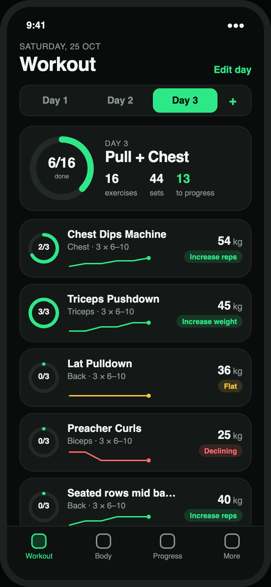<br><sub><b>Workout day</b><br>every exercise with its target; <i>All</i> shows everything</sub></td>
    <td align="center">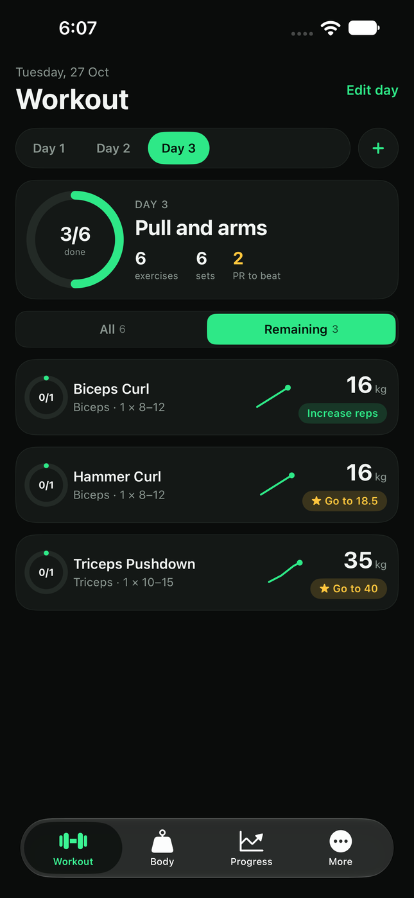<br><sub><b>Remaining</b><br>hides what is already logged today</sub></td>
    <td align="center">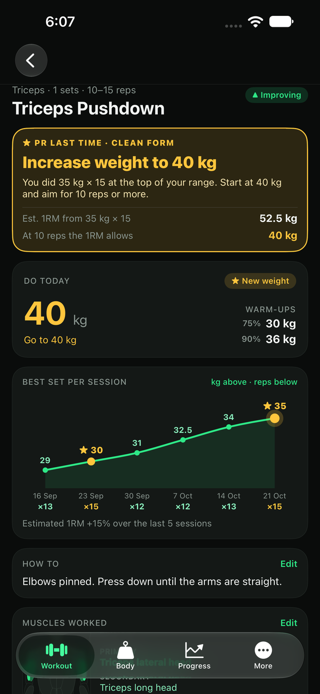<br><sub><b>PR banner</b><br>gold banner, next weight, estimated 1RM, gold ★ dot</sub></td>
  </tr>
  <tr>
    <td align="center">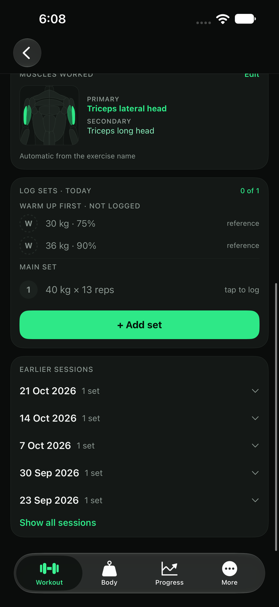<br><sub><b>Log sets</b><br>warm-ups as reference, one main set, earlier sessions to edit</sub></td>
    <td align="center">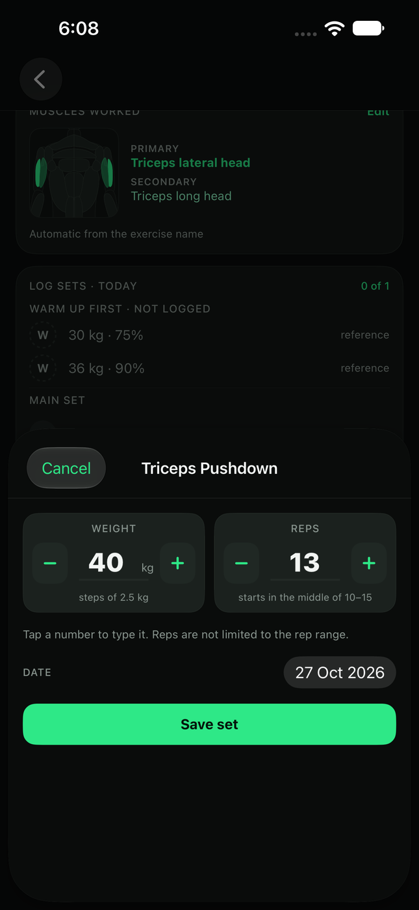<br><sub><b>Add set</b><br>− / + on weight and reps, reps start mid-range</sub></td>
    <td align="center">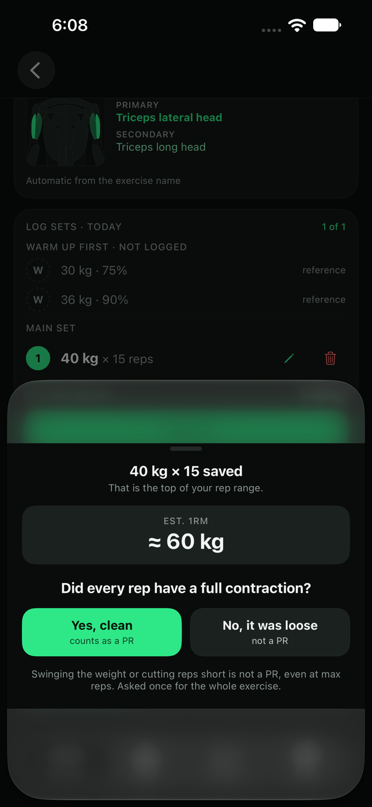<br><sub><b>Clean-form check</b><br>asked once when you reach the top reps</sub></td>
  </tr>
  <tr>
    <td align="center">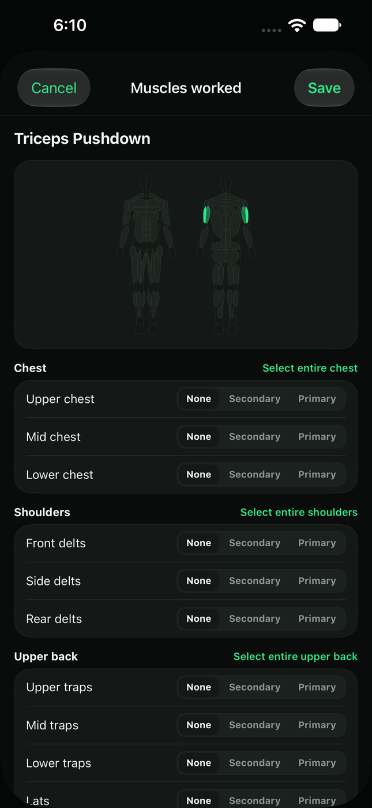<br><sub><b>Muscles worked</b><br>pick a whole region or single muscles</sub></td>
    <td align="center">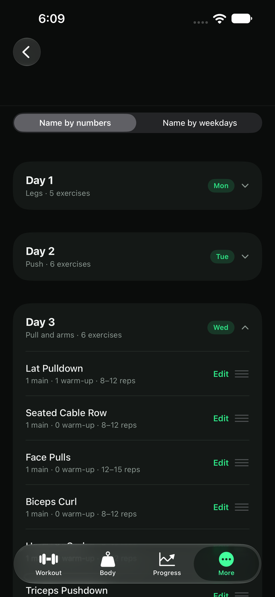<br><sub><b>Edit plan</b><br>main sets, warm-up sets, rep range</sub></td>
    <td align="center">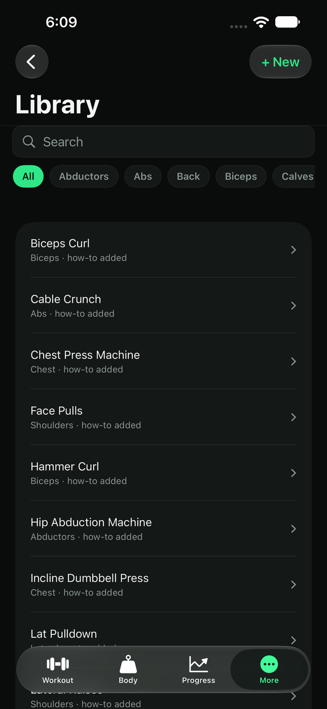<br><sub><b>Exercise library</b><br>names, muscle groups, how-to</sub></td>
  </tr>
</table>

### Body, progress and settings

<table>
  <tr>
    <td align="center">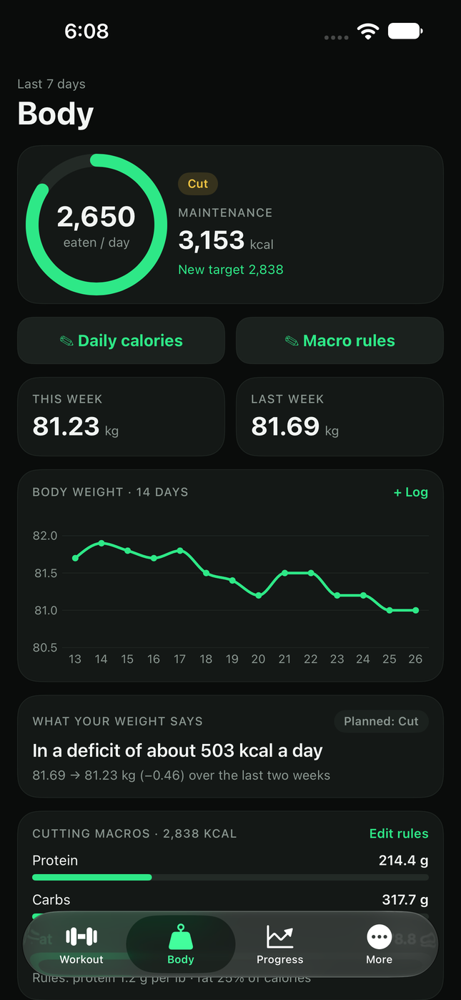<br><sub><b>Body</b><br>calorie target, weekly weight, what your weight says</sub></td>
    <td align="center">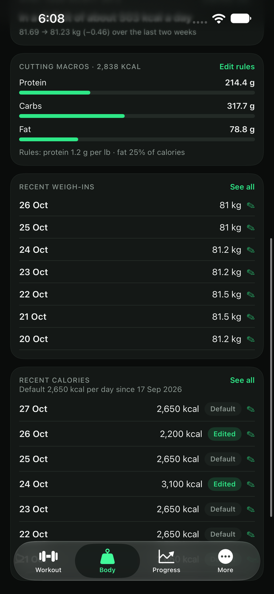<br><sub><b>Daily calories</b><br>default from a date, edit any day</sub></td>
    <td align="center">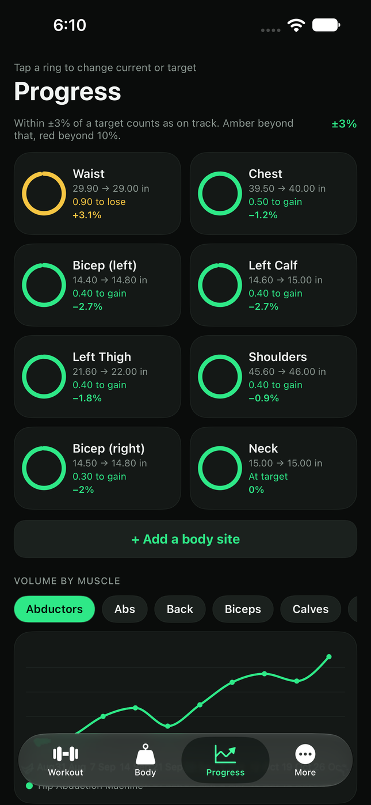<br><sub><b>Progress</b><br>measurements with % from target, volume per muscle</sub></td>
    <td align="center">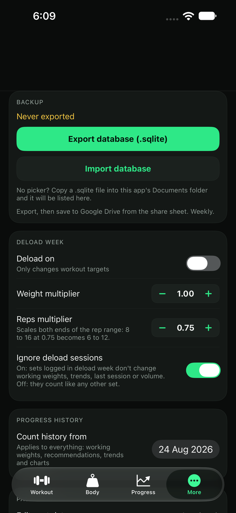<br><sub><b>More</b><br>backup, deload, history start, past data</sub></td>
  </tr>
</table>

## Features

**Training**
- **Workout per day:** each exercise shows its working weight and a progression chip. Pick a day, tap an exercise, log.
- **All / Remaining filter:** *Remaining* hides the exercises you have already finished today, so the last ones are not many scrolls away. The app always opens on *All*.
- **Main and warm-up sets:** the main set is logged and counted (the circle reads 0/1). Warm-ups (0 to 3 per exercise) are listed with their weights as a reference and are never logged.
- **PRs in gold:** reaching the top of the rep range with clean form is a PR. It shows as a gold banner, a gold ★ on the best-set chart and a gold chip on the list, with the next weight worked out from your estimated 1RM. If the form was not clean the app says to repeat the weight instead.
- **Clean-form check:** one question, asked once per exercise per day when you reach the top reps: "Did every rep have a full contraction?".
- **Fast logging:** − / + buttons on weight (2.5 kg steps) and reps, reps start in the middle of the range, log a set for an earlier day, edit or delete any set, and look up or fix any past day.
- **Best-set chart:** the best set of each session as a line (kg above each point, reps below), plus the estimated 1RM after every set.
- **Muscle diagram:** shows which muscles an exercise trains. It is automatic and editable per exercise, with a picture for every side of the body that has a worked muscle.
- **Deload mode:** a lighter week that scales the weight and both ends of the rep range for display only, with an option to ignore deload sessions in your progress.
- **Plan and library editing:** add, rename, reorder and delete days and exercises, set main sets, warm-up sets and rep ranges, and name days by number or weekday.

**Body and progress**
- **Weigh-ins:** log your weight on any day, edit or delete old ones.
- **Calories:** a daily default that starts on a date you choose, a change for any single day, and a calorie target with macros. Days that have a diet plan count the diet instead (see below), and a total you type for one day still wins.
- **What your weight says:** your actual deficit or surplus from the weight trend, next to your planned mode.
- **Measurements:** targets that grow or reduce, % from target, and a colour tolerance (green, amber, red).
- **Volume per muscle:** training volume over time for each muscle group.

**Diet**
- **Food library:** foods, supplements and packaged snacks with nutrition (per 100 g, per serving or per piece) and price. Calories come from the label when you type them, otherwise from protein, carbs and fat. Editing a food updates every day that used it.
- **Recipes:** a recipe is made of other foods, for one piece or a whole batch ("makes 9 pieces", "makes 1000 g"). Its nutrition and cost are worked out from the current ingredients.
- **Daily plan:** your meals and quantities. A change starts on a date you choose (today by default) and never rewrites earlier days. Nothing counts until you tick it: tick an item, or one box to tick a whole meal, as you eat.
- **Extras:** log something that is not in the plan by pieces, grams or share of a pack ("4 biscuits" from a 250 g pack of 35), see the result before saving, and re-add recent extras in one tap.
- **Cycles:** an item can follow a cycle: weeks on and off counted Monday to Sunday (for example 2 on, 1 off), days on and off, chosen weekdays, or training days. Off days are greyed, not counted in calories or cost, and need no tick.
- **Targets:** protein is a minimum (180 g by default). The fat limit is the smaller of 20% of the day's calories and a weight cap (7-day average weight in lb × 0.4 g). All three numbers are editable.
- **Cost and calories:** every day shows its total calories, macros and cost. The Body tab, the weekly average and the calorie target use these days.

**Data**
- **One SQLite file** on the phone. Export it, restore it, or import another one. Older files are upgraded automatically.

## Quick Start

For developers. Developed with Xcode 27.1 (Swift 6.4); the package targets iOS 16 and later. You also need [XcodeGen](https://github.com/yonaskolb/XcodeGen) (`brew install xcodegen`).

```bash
git clone https://github.com/ihiteshmodi/iphone-fitnessapp.git
cd iphone-fitnessapp

swift test                # logic tests, no simulator needed
# Expected (last lines): Executed 533 tests, with 10 tests skipped and 0 failures (0 unexpected)
#   the 10 skipped need a seeded database (see "Configuration")

xcodegen generate         # creates FitnessApp.xcodeproj from project.yml
# Expected: Created project at .../FitnessApp.xcodeproj

open FitnessApp.xcodeproj # pick an iPhone simulator and press Run
# Expected: the app opens on "Set up your data"; choose "Start empty" to try it
```

## Everyday commands

```sh
swift test                                   # logic tests, no simulator needed
cd tools/seed-db && python -m pytest         # seed tool tests (needs its own venv)
xcodegen generate                            # creates FitnessApp.xcodeproj from project.yml
scripts/run-ui-tests.sh WorkoutFlowUITests   # one UI test class, live progress, Ctrl-C to stop
```

The UI test runner shows a live progress bar and stops when the tests finish. Set `SIM_UDID` to the id of an iPhone simulator (`xcrun simctl list devices`). It uses `output/fitness.seed.sqlite`.

## Build an unsigned .ipa (for LiveContainer)

```sh
xcodegen generate
xcodebuild -project FitnessApp.xcodeproj -scheme FitnessApp -configuration Release -sdk iphoneos \
  -destination 'generic/platform=iOS' -derivedDataPath .derived-device \
  CODE_SIGNING_ALLOWED=NO CODE_SIGNING_REQUIRED=NO CODE_SIGN_IDENTITY="" build
# ** BUILD SUCCEEDED **
mkdir -p Payload && cp -R .derived-device/Build/Products/Release-iphoneos/FitnessApp.app Payload/ && zip -qry FitnessApp.ipa Payload
# FitnessApp.ipa is created in the current folder
```

If `output/fitness.sqlite` exists at build time it is bundled and offered as **Load my data** on first launch. Without it the build contains no data and the app starts on **Set up your data**.

## Install the .ipa on your iPhone

The .ipa you build is unsigned, so it has to be installed with a sideloading tool. Pick one:

**LiveContainer** ([project page](https://github.com/khanhduytran0/LiveContainer))
1. Install LiveContainer on your iPhone (it is itself sideloaded, see its README).
2. Get `FitnessApp.ipa` onto the phone (AirDrop, iCloud Drive or the Files app).
3. In LiveContainer open the **Apps** tab, tap **+**, and choose `FitnessApp.ipa`. Wait for it to finish installing.
4. Tap the app in the list to launch it.
5. If the file picker will not let you select a database file inside the app, open the app's settings in LiveContainer and turn on **Fix File Picker**.

**AltStore or SideStore** ([AltStore](https://altstore.io), [SideStore](https://sidestore.io))
1. Install AltStore or SideStore on your iPhone and sign in with your Apple ID.
2. Put `FitnessApp.ipa` on the phone, open the store app, go to **My Apps**, tap **+** and choose the file.
3. With a free Apple ID the app expires after 7 days; refresh it from the store app to keep it.

**Sideloadly** (Mac or Windows, [sideloadly.io](https://sideloadly.io))
1. Connect your iPhone, open Sideloadly and drag `FitnessApp.ipa` into it.
2. Enter your Apple ID and click **Start**.
3. On the iPhone, open **Settings → General → VPN & Device Management** and trust your Apple ID profile.

On iOS 16 and later you may also need to turn on **Developer Mode** (**Settings → Privacy & Security → Developer Mode**) and restart the phone. Menu names can differ slightly between versions.

## Usage

### Track your diet

1. **Diet** tab → **Foods**: add your foods (**+ New food**) with their label values, and recipes (**+ New recipe**) with their ingredients.
2. **Plan**: add each food to a meal with its quantity. Changes start on the date shown at the top (today by default). Tap an item to give it a cycle, such as 2 weeks on and 1 week off.
3. **Today**: nothing counts until you tick it. Tap an item to tick it as eaten, or tap the box next to a meal's name to tick or clear the whole meal. **+ Add extra** logs anything else.

Worked example (a 250 g pack of 35 biscuits, label per 100 g: 480 kcal, protein 7, carbs 70, fat 18; you ate 4):

```text
One piece:   250 ÷ 35 = 7.14 g
4 pieces:    4 × 7.14 = 28.6 g
Calories:    480 × 28.6 ÷ 100 = 137 kcal  (protein 2.0 g, carbs 20.0 g, fat 5.1 g)
```

Importing an existing spreadsheet of foods and a diet is possible with [`tools/diet-import`](tools/diet-import/README.md).

### Log a workout day

1. **Workout** tab: pick a day. Each card shows the working weight and a chip: green *Increase reps*, amber *Same weight, clean*, or gold *★ Go to 72.5*.
2. Tap **Remaining** to hide the exercises you have finished.
3. Open an exercise. Follow the warm-up weights, then tap **+ Add set**. Weight and reps have − / + buttons; tap a number to type it.
4. If the reps reach the top of the range, the app asks **"Did every rep have a full contraction?"**. Yes counts as a PR; No means the same weight next time.

Worked example (rep range 10 to 15, last session 35 kg × 15, answered Yes):

```text
Banner:        ★ PR last time · clean form — Increase weight to 40 kg
Est. 1RM:      35 × (1 + 15 / 30) = 52.5 kg
Next weight:   52.5 ÷ (1 + 10 / 30) = 39.4 → rounded to the nearest 2.5 kg = 40 kg
Do today:      40 kg   (warm-ups at 75% = 30 kg and 90% = 36 kg when 2 warm-up sets are planned)
```

## Configuration

There are no environment variables or secrets. The app is configured by settings stored in the database (change them in the app) and by two optional build-time files.

### Settings (stored in the `settings` table)

| Setting | Where in the app | Default | Required |
|---|---|---|---|
| Count history from | More → Progress history | `2026-08-31` (seeded) | No |
| Name days by | More → Plan / Edit plan | numbers | No |
| Deload on | More → Deload week | off | No |
| Deload weight multiplier | More → Deload week | `1` | No |
| Deload reps multiplier (both ends of the rep range) | More → Deload week | `0.75` | No |
| Ignore deload sessions in progress | More → Deload week | on | No |
| Protein g per lb | Body → Macro rules | `1.2` | No |
| Fat % of calories | Body → Macro rules | `25` | No |
| Protein minimum (diet) | Diet → Plan → Targets | `180` g | No |
| Fat share of calories (diet) | Diet → Plan → Targets | `20` % | No |
| Fat ceiling per lb of body weight (diet) | Diet → Plan → Targets | `0.4` g | No |
| Measurement tolerance | Progress → ±3% | `3` % (amber beyond it, red beyond 10%) | No |

### Build-time and launch options

| Option | What it does | Default | Required |
|---|---|---|---|
| `output/fitness.sqlite` | If present at build time it is bundled and offered as **Load my data** on first launch | absent (button hidden) | No |
| `output/fitness.seed.sqlite` | Test fixture built by `tools/seed-db`; used by the parity tests and the UI tests | absent (10 parity tests skip) | No |
| `-UITestImportPath <file>` | Simulator tests only: import this database at launch | unset | No |
| `-UITestInitialTab <0-4>` | Simulator tests only: start on a tab (0 Workout, 1 Body, 2 Diet, 3 Progress, 4 More) | `0` | No |

## Reference

This app has **no server and no HTTP API**. This section documents the local database and the rules the screens follow.

### Database tables (schema version 9)

| Table | Holds |
|---|---|
| `exercises` | Library: name, muscle group, how-to |
| `plan_days`, `plan_entries` | Training days and their exercises: main `sets`, `warmup_sets` (0 to 3), min and max reps |
| `set_logs` | Every logged set: date, exercise, weight kg, reps, deload flag |
| `form_checks` | Clean-form answer per exercise per day (1 clean, 0 not clean) |
| `exercise_muscles` | Muscles chosen per exercise (no rows means automatic) |
| `body_weights`, `body_measurements`, `measurement_targets` | Weigh-ins, readings, targets with a grow or reduce direction |
| `calorie_defaults`, `calorie_entries` | Calories per day from a start date, and single-day overrides |
| `foods`, `recipe_items` | Foods, supplements and packaged snacks with nutrition and price; recipes and their ingredient lines |
| `diet_plans`, `diet_plan_items` | The daily plan from a start date, with each item's meal, quantity and cycle |
| `diet_day_ticks`, `diet_extras` | Plan items ticked as eaten on a day, and extras eaten on top of the plan |
| `settings` | The settings above |

The schema lives in `src/shared/database/schema.sql`. Older files are upgraded in place when opened (versions 1 to 6 are covered by tests).

### Rules

| Rule | Definition |
|---|---|
| Estimated 1RM | Epley: `weight × (1 + reps ÷ 30)` |
| PR | A session reaching the top of the rep range with clean form (older sessions without an answer count as clean). Not during deload |
| Next weight after a PR | `1RM ÷ (1 + min reps ÷ 30)`, rounded to the nearest 2.5 kg, always above the weight lifted |
| Reps in Add set | Start at `ceil((min + max) ÷ 2)`, for example 8 to 16 gives 12 |
| Warm-ups | 1: 75%. 2: 75% and 90%. 3: 60%, 75% and 90% of the working weight |
| Calorie target | Maintenance = calories eaten minus the daily surplus implied by the change between the last two 7-day average weights (3,500 kcal per lb). Target = maintenance × goal multiplier |
| Calories on a day | The value typed for that day, else the ticked items of the diet plan in force plus extras (0 until something is ticked), else the default plus any extras |
| Food calories | The label value when typed, otherwise `4 × protein + 4 × carbs + 9 × fat` |
| Recipe | Ingredients added up, divided by what the recipe makes. Always worked out from the current foods |
| One piece | The weight typed for a piece, else `pack size ÷ pieces in the pack` |
| Diet fat limit | The smaller of `fat % × calories ÷ 9` and `7-day average weight in lb × 0.4` |
| Cycle | Weeks on and off count from a Monday and repeat; days on and off count from any date; weekdays and training days follow the calendar |
| Measurement colour | Only the wrong direction counts: within the tolerance is green, beyond it amber, beyond 10% red |

### Errors the app shows (validation messages)

| Message | When |
|---|---|
| `Reps must be at least 1` / `Weight cannot be negative` | Adding or editing a set |
| `Pick today or an earlier date` | Logging or editing a set for a future day |
| `Warm-up sets must be between 0 and 3` | Saving a plan entry |
| `Min reps cannot exceed max reps` | Saving a plan entry |
| `Tolerance must be between 0% and 50%` | Changing the measurement tolerance |
| `Log body weight for both of the last two weeks` | Calorie target without enough weigh-ins |
| `A food with that name already exists` / `Give the food a name` | Saving a food |
| `Flour is used by a recipe, a plan or a logged day` | Deleting a food that is still in use |
| `A recipe cannot contain itself` | Adding an ingredient that leads back to the recipe |
| `Enter an amount above 0` / `Loose rice has no piece size` | Adding an extra |
| `Choose at least one weekday` / `A weekly cycle starts on a Monday` | Saving a cycle |

## Database file

The live file is `Documents/fitness.sqlite` inside the app. Copy it out (Files app, or LiveContainer's "Open Data Folder") to back it up, or use **Export** in the More tab. To restore, copy a `.sqlite` file into the same `Documents` folder: it is listed on the first screen and under **More → Backup**. Older database versions are upgraded automatically on open.

```bash
sqlite3 fitness.sqlite "select count(*) from set_logs;"
# one number: how many sets you have logged
sqlite3 fitness.sqlite "select performed_on, weight_kg, reps from set_logs order by id desc limit 1;"
# one row, for example: 2026-10-26|35.0|15
```

## Layout

| Path | What |
|---|---|
| `src/shared/` | SQLite schema and wrapper, settings, exercise library |
| `src/modules/<capability>/<feature>/` | Domain logic per feature (planning, logging, nutrition, progress, data) |
| `tests/<capability>/<feature>/` | `.feature` scenarios and the XCTest specs that mirror them |
| `app/` | SwiftUI app (screens, theme, view models) |
| `appUITests/` | Simulator UI tests and the screenshot tours |
| `tools/seed-db/` | Python tool that builds a seeded database from a spreadsheet |
| `tools/diet-import/` | Python tool that imports a diet spreadsheet (foods, recipes, plan) into the database, and writes a made-up demo diet for the UI tests |
| `tools/anatomy/` | The muscle diagram source; `node tools/anatomy/generate-swift.js` writes the Swift data file |
| `docs/design/` | Impact maps, HTML mockups of every screen, and their screenshots |
| `scripts/run-ui-tests.sh` | UI test runner with a live progress bar |

## License

Licensed under the [PolyForm Noncommercial License 1.0.0](LICENSE). You may use, change and build on this app for noncommercial purposes, such as personal use, hobby projects, study, and non-profit or educational use. Commercial use needs my permission: contact me through my [GitHub profile](https://github.com/ihiteshmodi).
