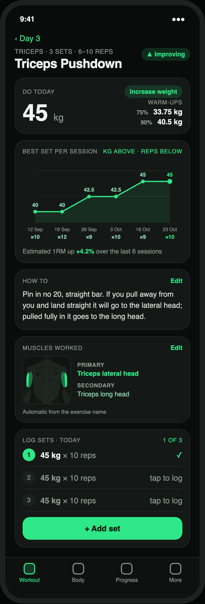
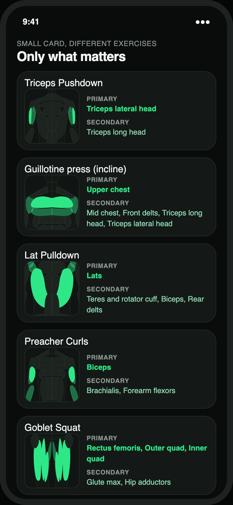
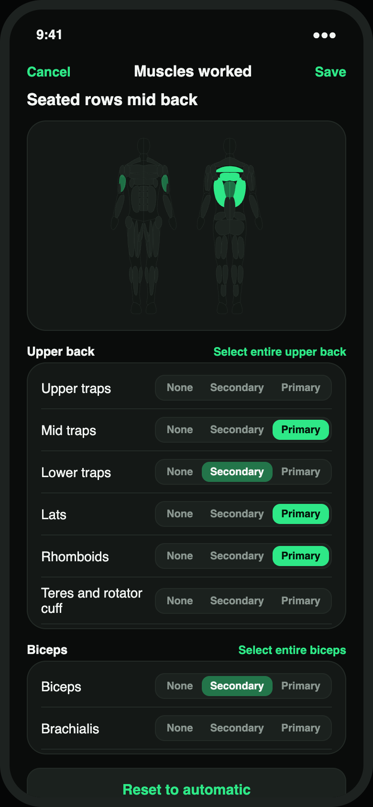
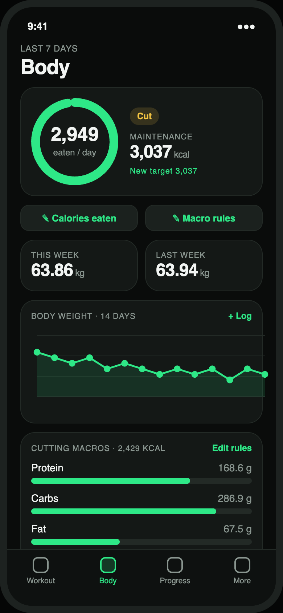
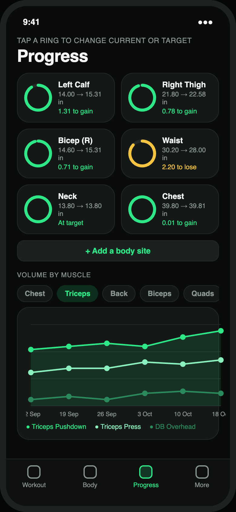
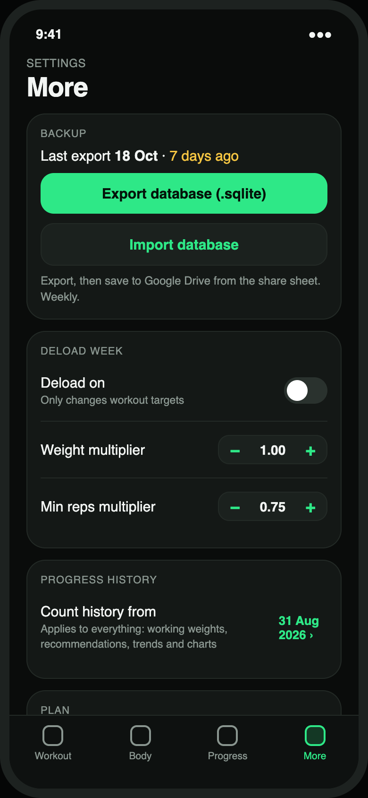
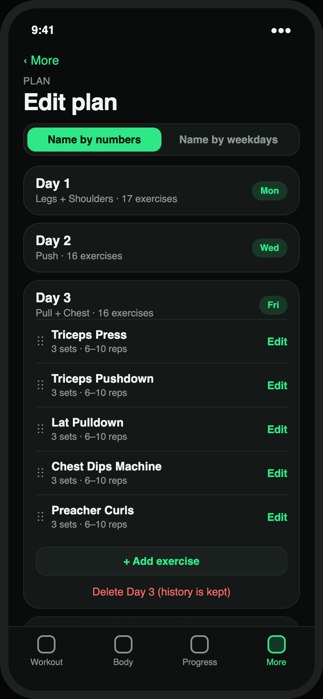
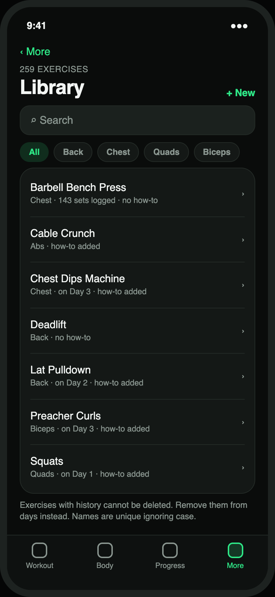
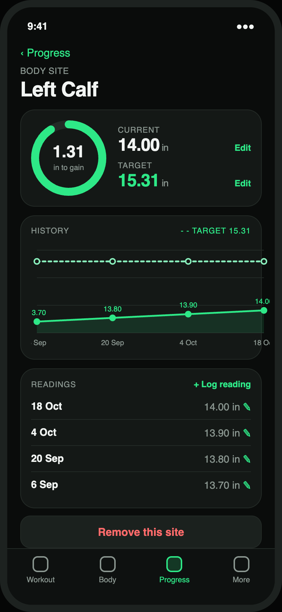
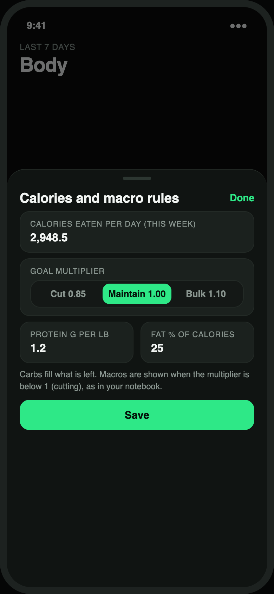

# Fitness app (iPhone, offline)

An offline iPhone app that replaces a weekly "notes → spreadsheet → Python notebook → screenshot" routine.
Log sets on the phone, get the next workout for each training day, track body weight, calories and measurements.
Everything lives in one SQLite file on the phone. No account, no backend.

**Features:** workout per day with working weight, warm-ups and a progression recommendation; exercise screen with the aim, a best-set line chart and inline set logging; muscle diagram showing which muscles an exercise trains (automatic, editable per exercise); deload mode (display only) and an option to ignore deload sessions in progress; plan and exercise-library editing; calorie target with macros; measurement progress (direction-aware); volume per muscle; database import, export and upgrade.

## Screens

These are the design mockups the app is built to match. They use sample data (see `docs/design/`), not real training data.

<table>
  <tr>
    <td align="center"><br><sub><b>Workout</b><br>pick a day, see every exercise</sub></td>
    <td align="center"><br><sub><b>Exercise</b><br>weight, aim, warm-ups, line chart, how to, muscles, logging</sub></td>
    <td align="center"><br><sub><b>Muscles worked card</b><br>zooms on what the exercise trains</sub></td>
  </tr>
  <tr>
    <td align="center"><br><sub><b>Muscle editor</b><br>pick a whole region or single parts</sub></td>
    <td align="center"><br><sub><b>Body</b><br>calorie target, weight trend, macros</sub></td>
    <td align="center"><br><sub><b>Progress</b><br>measurements to target, volume per muscle</sub></td>
  </tr>
  <tr>
    <td align="center"><br><sub><b>More</b><br>backup, deload, history start, plan</sub></td>
    <td align="center"><br><sub><b>Edit plan</b><br>add days, name by number or weekday</sub></td>
    <td align="center"><br><sub><b>Exercise library</b><br>names, muscles, how-to</sub></td>
  </tr>
  <tr>
    <td align="center"><br><sub><b>Measurement</b><br>change current and target</sub></td>
    <td align="center"><br><sub><b>Calories and macro rules</b><br>editable</sub></td>
    <td></td>
  </tr>
</table>

The muscle diagram is my own drawing, generated from `tools/anatomy/figure.js` (`node tools/anatomy/generate-swift.js` writes the Swift data file).

## Your data is not in this repository

The repository is public, so personal data is git-ignored: the spreadsheet, the notebook, the seeded database
(`output/fitness.sqlite`) and the `.ipa` (it embeds the database). Without a seeded database the app still works:
choose **Start empty** on first launch.

## Layout

| Path | What |
|---|---|
| `src/shared/` | SQLite schema and wrapper, settings, exercise library |
| `src/modules/<capability>/<feature>/` | Domain logic per feature (planning, logging, nutrition, progress, data) |
| `tests/<capability>/<feature>/` | `.feature` scenarios and the XCTest specs that mirror them |
| `app/` | SwiftUI app (screens, theme, view models) |
| `appUITests/` | Simulator UI tests |
| `tools/seed-db/` | Python tool that builds the seeded database from the spreadsheet |
| `docs/design/` | Impact map and HTML mockups of every screen |
| `scripts/run-ui-tests.sh` | UI test runner with a live progress bar |

## Everyday commands

```sh
swift test                                   # logic tests, no simulator needed
cd tools/seed-db && python -m pytest         # seed tool tests (needs its own venv)
xcodegen generate                            # creates FitnessApp.xcodeproj from project.yml
scripts/run-ui-tests.sh WorkoutFlowUITests   # one UI test class, live progress, Ctrl-C to stop
```

## Build an unsigned .ipa (for LiveContainer)

```sh
xcodegen generate
xcodebuild -project FitnessApp.xcodeproj -scheme FitnessApp -configuration Release -sdk iphoneos \
  -destination 'generic/platform=iOS' -derivedDataPath .derived-device \
  CODE_SIGNING_ALLOWED=NO CODE_SIGNING_REQUIRED=NO CODE_SIGN_IDENTITY="" build
mkdir -p Payload && cp -R .derived-device/Build/Products/Release-iphoneos/FitnessApp.app Payload/ && zip -qry FitnessApp.ipa Payload
```

If `output/fitness.sqlite` exists at build time it is bundled and offered as **Load my data** on first launch.
In LiveContainer, enable **Fix File Picker** for the app if the file picker will not select files.

## Database file

The live file is `Documents/fitness.sqlite` inside the app. Copy it out (Files app, or LiveContainer's
"Open Data Folder") to back it up, or use **Export** in the More tab. Older database versions are upgraded
automatically on open.
